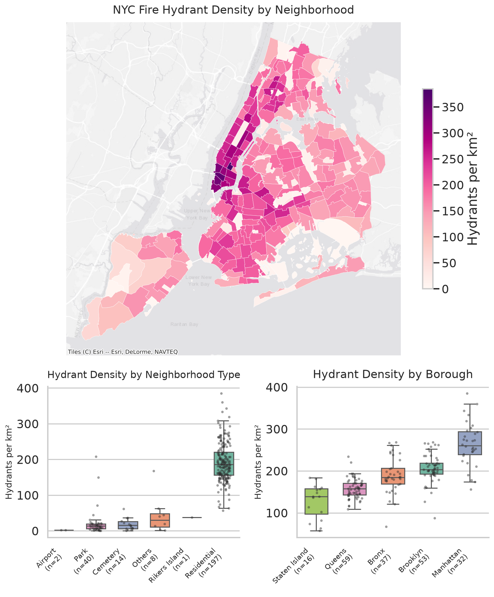

# NYC Hydrant Density Analysis

## The question

Where is hydrant coverage densest in NYC, and which neighborhoods are underserved relative to their area?

## The data

- **NYC Neighborhoods.** 262 polygons (2020 Neighborhood Tabulation Areas (NTAs), Source: [NYC Open Data](https://data.cityofnewyork.us/City-Government/2020-Neighborhood-Tabulation-Areas-NTAs-/9nt8-h7nd/about_data))
- **NYC Fire Hydrants.** 109,725 points (Source: [NYC Open Data](https://data.cityofnewyork.us/Environment/Hydrants/5bgh-vtsn/about_data))
- License: NYC Open Data Terms of Use
- All data in EPSG:4326

## Methodology

Built the same analysis twice:

- **SQL (PostGIS).** Five progressive queries in `analysis.sql`, going from simple filter to spatial join to area-normalized density to 100m-buffer coverage analysis.
- **Python (GeoPandas).** Equivalent pipeline in `analysis.ipynb`, with a static choropleth and interactive `.explore()` map. Final output exported to GeoParquet.

Both pipelines produce the same density values to within rounding. The Python version produces the visualization. The SQL version runs against a database at scale.

## Findings

- Top 5 neighborhoods by hydrant density (per km²):
  1. Gramercy
  2. SoHo-Little Italy-Hudson Square
  3. Tribeca-Civic Center	
  4. West Village	
  5. Financial District-Battery Park City
- Bottom 5 neighborhoods (least coverage):
  1. New Springville-Willowbrook-Bulls Head-Travis
  2. Tottenville-Charleston
  3. Co-op City	
  4. Todt Hill-Emerson Hill-Lighthouse Hill-Manor H...
  5. Mariner's Harbor-Arlington-Graniteville
- Median residential neighborhood has 185 hydrants per km².
- At least 48% of every residential neighborhood is within 100m of a hydrant.



## How to run it

Requires Docker (for PostGIS) and Python 3.11+ with GeoPandas.

```bash
git clone https://github.com/{your-username}/nyc-hydrant-analysis.git
cd nyc-hydrant-analysis

# Start the PostGIS template (copy from R2.4 docker-templates/postgis/)
docker compose -f docker/postgis/docker-compose.yml up -d

# Load NYC Open Data into PostGIS (your script of choice)
# Then run the SQL pipeline
psql -h localhost -U gisuser -d nyc -f analysis.sql

# Then the Python pipeline
jupyter lab analysis.ipynb
```

## What I learned

- How to design the same geospatial analysis methods in GeoPandas and PostGIS. Writing the geospatial analysis SQL is more efficient and usually faster. This will be more true for larger datasets.
- Doing spatial joins to combine data sources and obtain statistics about each neighborhood.
- There were significant differences in distribution in residential areas versus cemetery, park, Rikers Island, and airport. For example, hydrants per km2 and hydrants per street km showed completely different responses, likely because residential areas are designed to be driven around. 

## Stack

- PostGIS 16-3.4 (via Docker)
- GeoPandas + SQLAlchemy + matplotlib
- Jupyter Lab
- GeoParquet

## Post 

[Link to the LinkedIn post.](https://lnkd.in/p/gUArfu6Y)